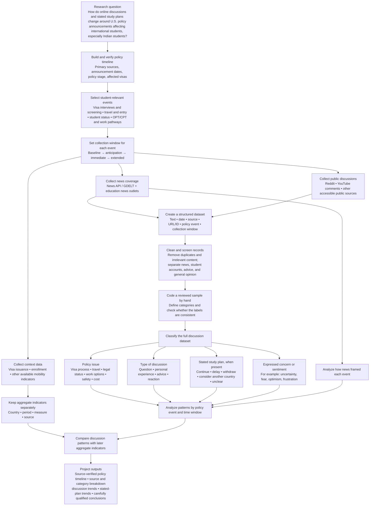

# Project workflow

This flowchart connects U.S. policy announcements, news coverage, online discussion, and international-student mobility indicators. The study period is 2025–2026, with particular attention to Indian students. Events first enter a candidate list; each source, date, policy stage, and affected student or work pathway must be checked before an event is used in analysis.

**Classification rule:** A post expressing worry about a visa is coded as a concern, but it is not coded as a decision to delay or withdraw unless the writer explicitly states that plan. News coverage, student experiences, and general public comments remain identifiable as separate source types.

**Policy verification gate:** The event collector and its LLM produce candidates, not verified policy facts. Check the primary source for the announcement date, whether the item is proposed or final, affected visa classes, and direct relevance to international students. Check any earlier news signal against the linked article before using it to set an anticipation window. Keep the event source URL and verification notes with the timeline. The analysis windows end at the fixed study stop date, October 1, 2026.
